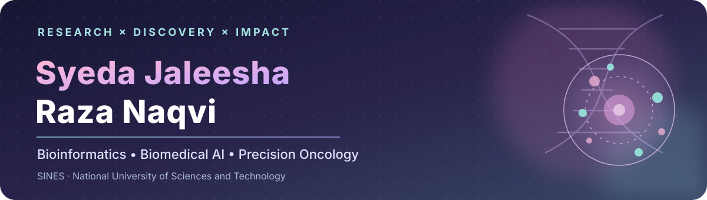
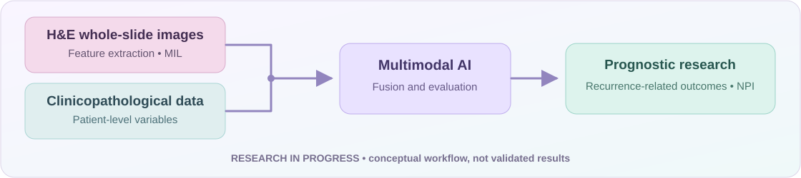

  

  
  
  

  <a href="#-current-research--breast-cancer--multimodal-ai">Current research</a> •
  <a href="#-selected-computational-projects">Projects</a> •
  <a href="#-research-toolkit">Toolkit</a> •
  <a href="#-academic-journey">Education</a> •
  <a href="#-lets-connect">Contact</a>

# Hello, I'm Jaleesha 🌷

I am **Syeda Jaleesha Raza Naqvi**, an **MS Bioinformatics researcher at SINES, National University of Sciences and Technology (NUST), Islamabad** and a **Research Assistant working at the intersection of precision oncology, computational pathology, and biomedical artificial intelligence**.

My work connects biological questions with computational methods: from histopathology images and clinicopathological records to machine learning, molecular biology, and nanomedicine. I care about research that is **rigorous, interpretable, and clinically meaningful**.

## 🔬 Current research | Breast cancer & multimodal AI

**MS thesis:** *AI-Guided Recurrence Risk Stratification in Breast Cancer Using H&E Histopathology and Clinicopathological Data*  
**Supervisor:** Prof. Dr. Ishrat Jabeen · **Status:** Ongoing (MS expected 2027)

Within a NUST-funded precision oncology–pathology project, I am investigating how routine H&E histopathology and clinicopathological information can be brought together for **breast cancer recurrence-risk stratification**.

- **Scientific focus:** recurrence-related outcomes and established prognostic measures, including the **Nottingham Prognostic Index (NPI)**.
- **Computational direction:** whole-slide image features, attention-based multiple-instance learning, clinical-variable modelling, and multimodal integration.
- **Evaluation priorities:** patient-level data separation, comparison with clinical-only and image-only baselines, robust validation, and transparent limitations.

> **Research status:** Data preparation and analysis are ongoing. Model development, comparative evaluation, and external validation are research goals—not completed or published results.

## 🧩 My research approach

  

I aim to connect **biological validity**, **careful data preparation**, and **transparent model evaluation**. My current work examines how complementary modalities may improve the *study* of patient outcomes; it does not assume that multimodal models automatically outperform established clinical measures.

## 🧠 Selected computational projects

| Project | What I worked on |
| :-- | :-- |
| **Domain-specific GPT-2 pretraining from scratch** | Prepared **5M+ text tokens** from Australian government and educational sources; trained **GPT-2 Small (124M parameters)** without pretrained weights; implemented tokenization, checkpoints, GPU-conscious batching, and training-loss/perplexity tracking. |
| **CNN vs LSTM vs Transformer** | Trained and compared autoregressive language models for next-word prediction using **PyTorch, SentencePiece, and OpenWebText**, with validation perplexity as a comparison measure. |
| **Clinical cardiovascular risk modelling** | Explored clinical and behavioral factors in people with diabetes using **simple and multiple linear regression**. |
| **Neural-network benchmarking** | Implemented **MLP/CNN** classifiers and compared performance across **MNIST, Iris, CIFAR-10, and Fashion-MNIST**. |

*Project descriptions summarize completed research/training work from my academic CV. Public code repositories will be linked as they become available.*

## 🧪 Research & laboratory experience

- **Research Assistant · Precision Oncology & Biomedical AI** — SINES, NUST *(Aug 2026–present)*. Investigating histopathology–clinical integration and prognostic assessment within a NUST-funded breast cancer research project.
- **Undergraduate Thesis Researcher · Biomedical Nanomaterials** — Kinnaird College for Women *(Sep 2024–Jun 2025)*. Nanocomposite synthesis, characterization, and antioxidant assessment.
- **Research Intern · Molecular Biology** — Centre of Excellence in Molecular Biology (CEMB), University of the Punjab *(Jun–Aug 2024)*. Western blotting, ELISA, and laboratory data collection.
- **Laboratory Intern · Biological Assays** — Pakistan Council of Scientific and Industrial Research (PCSIR) *(Jun–Aug 2023)*. Antimicrobial, anti-inflammatory, and toxicological assays.

## 🛠️ Research toolkit

| Area | Tools and methods |
| :-- | :-- |
| **Programming & research computing** | Python · R · Bash · MATLAB · Linux · Git/GitHub · Jupyter · Google Colab · Kaggle |
| **AI & machine learning** | PyTorch · TensorFlow · Keras · scikit-learn · CNNs · LSTMs · transformers · model evaluation |
| **Analysis & visualization** | NumPy · pandas · Matplotlib · Seaborn · Plotly · SPSS · Excel |
| **Bioinformatics & biomedicine** | BLAST · genomics and NGS analysis · histopathological image analysis · clinical data preprocessing · statistical modelling |
| **Experimental biology** | Western blotting · ELISA · UV–Vis · FTIR · XRD · nanocomposite synthesis · biological activity assays |

My interests span **computational pathology, biomedical AI, machine learning, bioinformatics, genomics, and cancer nanomedicine**.

## 📄 Research manuscript

**“Stimuli Responsive Chitosan-Based Nanohybrids for Targeted Cancer Therapy via Delivery of Bioactive Compounds and Therapeutic Agents”**

*Review manuscript · International Journal of Immunopathology and Pharmacology · Revised submission under consideration (2026).*

**Contribution:** Second-listed author and equal contributor, as designated in the manuscript.  
**Publication status:** **Under consideration, not yet published**; a publication link will be added only after an official record is available.

## 🎓 Academic journey

| Period | Degree / institution | Focus |
| :-- | :-- | :-- |
| **2025–2027 (expected)** | **MS Bioinformatics** · SINES, NUST, Islamabad | Biomedical AI, multimodal computational pathology, breast cancer risk stratification |
| **2021–2025** | **BS (Hons.) Biotechnology** · Kinnaird College for Women, Lahore | Experimental biotechnology, biomedical nanomaterials, antioxidant evaluation |

My undergraduate thesis examined **silver-doped ZnO/graphene oxide nanocomposites**, with and without vitamin E loading, using **UV–Vis, FTIR, XRD** and antioxidant assays including **FRAP, CUPRAC, ABTS, and ORAC**.

## 💌 Let's connect

I welcome thoughtful conversations about **precision oncology, biomedical AI, computational pathology, reproducible bioinformatics, and interdisciplinary research**.

  
  
  

---

Curiosity in biology. Care in computation. Purpose in research. ✦

